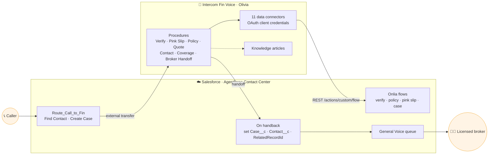

<div align="center">

# 🛡️ Onlia · Ollie ➜ Olivia

### Migrating a Salesforce **Agentforce** Service Agent to an **Intercom Fin** Voice Agent


**[📘 Read the conversion guide](docs/agentforce-to-fin-conversion-guide.md)** · [🗺️ Migration map](docs/migration-map.md) · [📞 Test-call script](docs/test-call-script.md) · [🔌 Connector specs](fin/data-connectors/connector-specs.md)

</div>

---

> [!TIP]
> **New here? Start with the [Agentforce → Fin conversion guide](docs/agentforce-to-fin-conversion-guide.md).** It shows what every Agentforce instruction, subagent, variable, filter, flow and Apex action became in Fin, with a worked example and a step-by-step method you can reuse.

## ✨ What it does

| | Step | Where it happens |
|:-:|---|---|
| 1️⃣ | Call arrives; the caller's **Contact** is found by phone and a **Case** is created | Salesforce routing flow |
| 2️⃣ | The call is transferred to **Olivia** on Fin Voice | Salesforce → Fin |
| 3️⃣ | Caller is verified with an **emailed one-time code** | Fin → Salesforce flows |
| 4️⃣ | Policy, quote, pink slip (email or mail), contact updates | Fin procedures + data connectors |
| 5️⃣ | Coverage and billing questions answered from **knowledge articles** | Fin knowledge |
| 6️⃣ | Before any broker handoff, the **Case is updated** with a subject and summary | Fin → Salesforce |
| 7️⃣ | Caller returns to Salesforce with **Case + Contact on the Voice Call**, queued to a broker | Salesforce routing flow |

## 🏗️ Architecture



## 📁 Repository layout

```text
onlia-agentforce-to-fin/
├── 📘 docs/
│   ├── agentforce-to-fin-conversion-guide.md   ← how every piece was converted
│   ├── migration-map.md                        ← original inventory of the v10 agent
│   └── test-call-script.md                     ← what to say on a test call
├── 💬 fin/
│   ├── procedures/        7 live Fin procedures (YAML)
│   ├── guidance/          persona + read-back rules (and 3 disabled escalation rules)
│   ├── simulations/       fully mocked tests (Pink Slip, Policy Details)
│   └── data-connectors/   specs for the 11 connectors
├── ☁️ salesforce/         SFDX project: flows, Apex, agent bundle, Route_Call_to_Fin
├── 🤖 source-agent/       the original Agentforce agent (+ decoded Agent Script)
├── 🛠️ scripts/            verification test, simulation viewer, careful patch scripts
└── 🔌 plugin/             Claude Code plugin config for the Intercom MCP server
```

## 🔌 Data connectors at a glance

<table>
<tr><th>🔐 Identity</th><th>📄 Policy & quote</th><th>✉️ Fulfilment & account</th><th>🗂️ Case</th></tr>
<tr valign="top">
<td>Send Verification Code<br/>Verify Code</td>
<td>Find Active Policy<br/>Find Quote</td>
<td>Send Pink Slip Email<br/>Send Pink Slip Mail<br/>Update Contact<br/>Schedule Callback</td>
<td>Find Latest Case<br/>Update Case<br/>Update Or Create Case</td>
</tr>
</table>

All of them call `POST {instance}/services/data/v68.0/actions/custom/flow/<Flow>` (or a SOQL `GET`) with one OAuth client-credentials token. A response code block passes **only allow-listed fields** to Fin; the one-time code, GWP and commission never reach the model.

## 🚀 Setup

<details>
<summary><b>1. Salesforce</b>: deploy the project and create the OAuth app</summary>

```bash
cd salesforce
sf project deploy start -o <org-alias>
```

Create an **External Client App** with the client-credentials flow and a run-as integration user.
</details>

<details>
<summary><b>2. Fin</b>: authentication and data connectors</summary>

- Create an **OAuth Authentication token** pointed at `{instance}/services/oauth2/token`.
- Create each connector from [`connector-specs.md`](fin/data-connectors/connector-specs.md).
- **Live-test, then publish** each one; procedures can't call draft connectors.
- Turn off Fin's customer-verification requirement on voice connectors (the email code is the gate).
</details>

<details>
<summary><b>3. Procedures and guidance</b>: upload and publish correctly</summary>

```bash
intercom --no-retry fin procedures upload fin/procedures/pink-slip.yaml --verify
intercom --no-retry fin procedures pause   <procedure-id>
intercom --no-retry fin procedures publish <procedure-id>
intercom fin procedures versions <procedure-id>   # confirm YOUR version is "live"
```

> [!IMPORTANT]
> On an already-live procedure, `publish` alone does **not** make the new version live. Pause first, then publish, then check `versions`.
</details>

<details>
<summary><b>4. Voice</b>: route the Salesforce number to Fin</summary>

Point the Salesforce phone number's routing at **`Route_Call_to_Fin`**, which transfers to the Fin number and links Case + Contact when Fin hands back.
</details>

> [!NOTE]
> The test caller email is the placeholder `test.caller@example.com`. Org-specific IDs (instance URL, record IDs) come from the demo org.

## 🧠 Lessons that cost the most time

| ⚠️ Gotcha | ✅ What to do instead |
|---|---|
| `publish` on a live procedure keeps the **old** version live | `pause` → `publish` → check `procedures versions` |
| **Escalation guidance** makes Fin hand off immediately, skipping procedures | Keep broker routing inside procedures; leave escalation rules off |
| Fin's built-in "asked for a human" escalation beats later steps | Put the Broker Handoff steps **inside** each procedure (sub-procedure), not a `<switch>` |
| Fin chains actions only **until it speaks**; later steps get skipped | Write to the case **before** the spoken confirmation |
| Extra actions in one step are ignored; nested `decide` is rejected | **One action per step** |
| Simulations without mocks can replay saved connector responses | **Mock every connector** |
| Native telephony sets `CallEndDateTime` when the call is created | Don't use it to check whether a call is still open |
| Console panels and Service Assistant don't load without a related record | Resolve the Contact on the Voice Call first; set the Case as **Related Record** |

> [!WARNING]
> **Trial-org email limit.** The demo org allows **15 single emails a day**. Once it's used up, verification codes and pink slips silently stop arriving, while the flows still report success.
