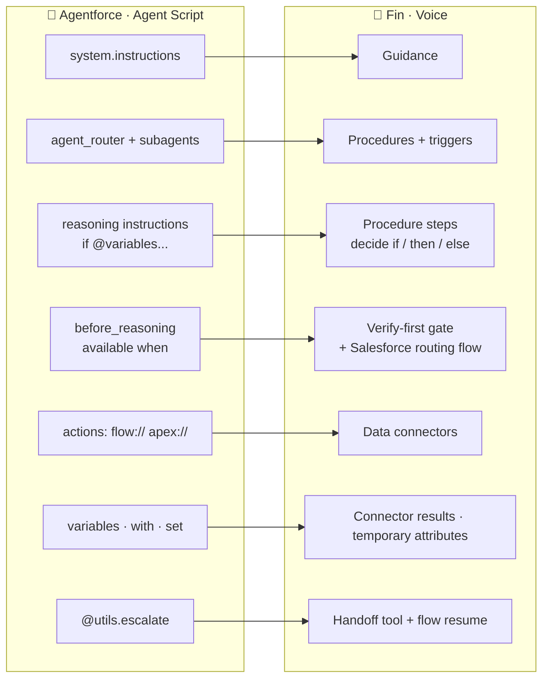
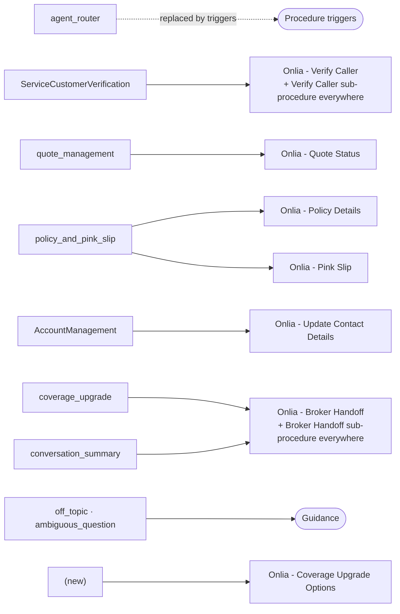
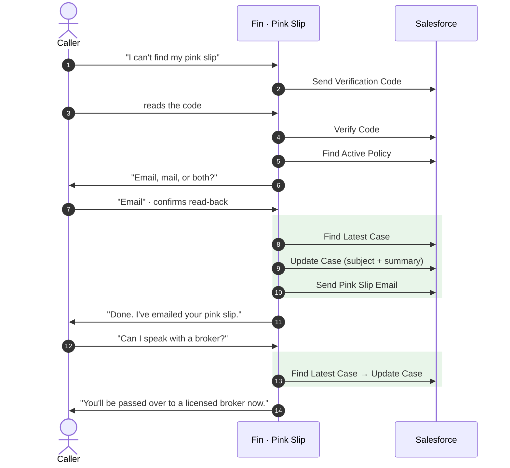
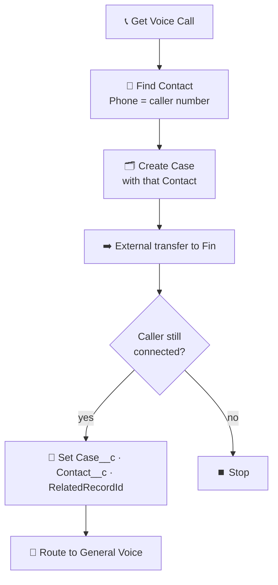
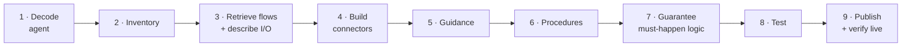

<div align="center">

# 🔁 Agentforce ➜ Fin Conversion Guide

### How the Onlia Service Agent **"Ollie"** became the Fin voice agent **"Olivia"**


</div>

> [!TIP]
> **Use this as a playbook.** Section 1 is the one-page cheat sheet. Sections 2–6 go block by block with real Onlia examples, and Section 7 is the order to do it in.

**Sources for every example**

| | File |
|---|---|
| 🤖 Agentforce | [`source-agent/Onlia_Service_Agent_v10.decoded.agent`](../source-agent/Onlia_Service_Agent_v10.decoded.agent) |
| 💬 Fin | [`fin/procedures/`](../fin/procedures) · [`fin/guidance/`](../fin/guidance) · [`fin/data-connectors/connector-specs.md`](../fin/data-connectors/connector-specs.md) |
| ☁️ Salesforce glue | [`Route_Call_to_Fin.flow-meta.xml`](../salesforce/force-app/main/default/flows/Route_Call_to_Fin.flow-meta.xml) |

## 📑 Contents

1. [The one-page mapping](#1--the-one-page-mapping)
2. [Subagents → procedures](#2--subagents--procedures)
3. [Actions → data connectors](#3--actions--data-connectors)
4. [Variables → what replaced them](#4--variables--what-replaced-them)
5. [Worked example: Pink Slip](#5--worked-example-pink-slip)
6. [The Salesforce side Fin needs](#6--the-salesforce-side-fin-needs)
7. [Step-by-step method](#7--step-by-step-method)
8. [Rules learned the hard way](#8--rules-learned-the-hard-way)
9. [Current gaps](#9--current-gaps)

---

## 1 · The one-page mapping



| Agentforce (Agent Script) | What it does there | ➜ Fin equivalent | Onlia example |
|---|---|---|---|
| `system.instructions` | Persona and global rules on every turn | **Guidance** (communication style), voice channel | `fin/guidance/ollie-persona.yaml` |
| `system.messages.welcome` | Opening line | Persona guidance greeting / Fin Voice greeting | "Thank you for contacting Onlia Insurance…" |
| `start_agent agent_router` | Routes each turn to a subagent | **No router.** Each procedure's `trigger_description` + positive/negative triggers | `trigger_description` in every procedure |
| `subagent <name>` | A topic with its own instructions and actions | **Procedure** (one per job) | `policy_and_pink_slip` → Policy Details + Pink Slip |
| `reasoning.instructions` | Natural-language guidance for the topic | **Procedure steps** (ordered) + procedure `guidance` | Pink Slip steps 1–9 |
| `if @variables.X:` in instructions | Conditional instructions | **`decide` step** (`if / then / else`, natural-language condition) | "if the caller wants it by email AND said yes" |
| `before_reasoning` | Deterministic code before the LLM | **First steps of the procedure**, or the **Salesforce routing flow** when it must be guaranteed | Pink Slip runs Find Active Policy first; the flow finds the Contact and creates the Case |
| `available when <condition>` | Hides an action until a condition holds | **Verify-first gate** at the top of the procedure | "If there is NO successful Onlia Verify Code result → run Verify Caller" |
| `@utils.transition to @subagent.X` | Move to another topic | `run: <Sub-procedure>` in the same procedure ✅ · `<switch to="…"/>` ⚠️ unreliable | Pink Slip `run: Verify Caller`, `run: Broker Handoff` |
| `@utils.escalate` + `connection telephony` | Hand off with an escalation message | **Procedure handoff tool** (`type: handoff`) + Salesforce flow resuming after Fin leaves | `handover_message: You'll be passed over to a licensed broker now.` |
| Linked variables (`@VoiceCall.Contact__c`, `@MessagingSession.Id`) | Context from the Salesforce session | **Not available to Fin.** Resolved by the routing flow or from verification output | `Route_Call_to_Fin`: Find Contact by caller phone |
| Mutable variables (`isCustomerVerified`, `authKey`, `EffectiveContactId`) | Memory across turns | **Connector results in the conversation**, named in steps; **temporary attributes** for carried values | "customerId from the successful Onlia Verify Code result"; `temporary.verified_email` |
| `with input = @variables.y` | Deterministic input binding | **Connector data input**; the description and step text name the source | `contactId` = verified `customerId` |
| `with input = ...` | LLM fills the input | **Connector data input** collected by the step | `confirmedEmail`, `newStreetAddress` |
| `set @variables.x = @outputs.y` | Store an output | Nothing to configure; steps reference the result by name | "authenticationKey, customerId, customerType from the latest Send Verification Code result" |
| `filter_from_agent: True` / `is_displayable` | Keep output away from LLM / user | **Response code block** returning an allow-list | Send Verification Code drops `verificationCode`; Find Active Policy drops `gwp` |
| `require_user_confirmation: True` | Confirm before running | **Read-back + explicit "yes"** step; connector flagged as write action | Pink Slip email/mail, Update Contact |
| `target: "flow://X"` | Run a Salesforce flow | **Data connector** → `POST /services/data/v68.0/actions/custom/flow/X` | 9 of the 11 connectors |
| `target: "apex://X"` (card renderers) | Apex + Custom Lightning Type card | **Dropped for voice**; flow data spoken instead | `OnliaGetPolicySummaryAction` → Find Active Policy |
| Custom Lightning Types / `show_command` | Rich chat cards | **Spoken sentences** | "Speak the policy type and number" |
| `progress_indicator_message` | "One sec…" | Fin's own filler; guidance: "If you need a moment, just say 'One moment.'" | `natural-speech-and-read-backs.yaml` |
| `off_topic`, `ambiguous_question` | Redirect and clarify | **Guidance** | Persona guidance |
| `modality voice` | Voice settings | **Fin Voice channel settings** (UI) | Not migrated as code |
| *(none)* | — | **Knowledge (internal articles)** | 5 Onlia articles for Coverage Upgrade Options |

---

## 2 · Subagents → procedures



| Agentforce subagent | ➜ Fin procedure(s) | Notes |
|---|---|---|
| `agent_router` | *(none)* | Replaced by procedure triggers. Verify Caller's triggers are account-specific, so general questions never force verification. |
| `ServiceCustomerVerification` | **Onlia - Verify Caller** + a **Verify Caller sub-procedure in every account procedure** | Each account procedure starts with "if not verified → run Verify Caller", reproducing `available when isCustomerVerified == True`. |
| `quote_management` | **Onlia - Quote Status** | Quote card (Apex) dropped; number, status and expiry are spoken. |
| `policy_and_pink_slip` | **Onlia - Policy Details** and **Onlia - Pink Slip** | Split into two jobs. Pink Slip looks up the policy first, as `before_reasoning` did. |
| `AccountManagement` | **Onlia - Update Contact Details** | `ResetSecurePassword` dropped: its flow is a placeholder screen flow and can't be a connector. |
| `coverage_upgrade` + `conversation_summary` | **Onlia - Broker Handoff** + a **Broker Handoff sub-procedure in every account procedure** | Upgrade-options card dropped. Case summary now uses Find Latest Case + Update Case. |
| `off_topic`, `ambiguous_question` | Guidance | No procedure needed. |
| *(new)* | **Onlia - Coverage Upgrade Options** | Answers from knowledge without verification; verifies only if the caller asks about *their* policy. |

---

## 3 · Actions → data connectors

Every flow the agent called is an **invocable action**, so Fin calls the *same* flow over REST.

> [!TIP]
> Find an action's real inputs and outputs **without running it**. A `GET` is a describe-only call:
> ```bash
> sf api request rest "/services/data/v68.0/actions/custom/flow/<FlowName>" -o <org>
> ```

| Agentforce action (`target`) | ➜ Fin data connector | Change |
|---|---|---|
| `SendEmailVerificationCode` · `flow://SvcCopilotTmpl__SendVerificationCode` | 🔐 Onlia Send Verification Code | Code block **drops `verificationCode`** |
| `VerifyCustomer` · `flow://SvcCopilotTmpl__VerifyCode` | 🔐 Onlia Verify Code | Code + `authenticationKey`, `customerId`, `customerType` from the send |
| `find_quote` · `flow://Onlia_Find_Quote` | 📄 Onlia Find Quote | Same |
| `find_active_policy` · `flow://Onlia_Find_Active_Policy` | 📄 Onlia Find Active Policy | Code block **drops `gwp`** |
| `send_pink_slip_email` · `flow://Onlia_Send_Pink_Slip_Email` | ✉️ Onlia Send Pink Slip Email | Write action; read-back + yes |
| `send_pink_slip_mail` · `flow://Onlia_Send_Pink_Slip_Mail` | ✉️ Onlia Send Pink Slip Mail | Write action |
| `UpdateVerifiedContact` · `flow://SvcCopilotTmpl__UpdateVrfyCtct` | ✉️ Onlia Update Contact | Write action; only changed fields sent |
| `schedule_callback` · `flow://Onlia_Schedule_Callback` | ✉️ Onlia Schedule Callback | Same |
| `update_or_create_case` · `flow://Onlia_Update_Or_Create_Case` | 🗂️ Onlia Update Case + 🗂️ Onlia Update Or Create Case | **Split:** the flow tests `recordId` for *null*, and Fin sends blanks as `""` |
| `get_case_from_session` · `flow://Onlia_Get_Case_From_Session` | 🗂️ Onlia Find Latest Case (SOQL `GET /query`) | MessagingSession doesn't exist on a voice call |
| `Get_Quote_Summary`, `Get_Policy_Summary`, `Get_Upgrade_Options` (Apex) | 🚫 dropped | Chat card renderers |
| `call_now` · `flow://Initiate_Outbound_Call_for_Contact` | 🚫 dropped | Caller is already on the phone |
| `ResetSecurePassword` | 🚫 dropped | Placeholder screen flow |

**Rules applied to every connector**

- 🔑 One OAuth token (Fin **Authentication** → client credentials against `/services/oauth2/token`).
- 🧹 The response is a one-item array; a code block reads `[0].outputValues` and returns **only allow-listed fields** plus `isSuccess` and `errors`. This is how `filter_from_agent` is reproduced.
- 📞 Turn off Fin's customer-verification requirement on voice connectors; voice callers have no Intercom identity, and the email code is the gate.
- ✅ A connector must pass a **live test** before it can be published, and procedures only call **published** connectors.

---

## 4 · Variables → what replaced them

| Agentforce variable | Kind | ➜ Fin replacement |
|---|---|---|
| `ChannelType` | mutable | ❌ Removed: procedures target the `phone_call` channel only |
| `VoiceCallId`, `CallerId`, `Contact` (`@VoiceCall.Contact__c`) | linked | ☁️ Routing flow: **Find Contact** by caller phone → Voice Call → Case |
| `EndUserId`, `RoutableId`, `ContactId`, `EndUserLanguage` | linked (messaging) | ❌ Not applicable on voice |
| `isCustomerVerified` | mutable | "There is a successful Onlia Verify Code result in this conversation" |
| `authKey`, `ResolvedContactId`, `Resolved_Contact_Type` | set from outputs | Taken from **the latest** Send Verification Code result, named in the Verify step |
| `EffectiveContactId` | mutable | "customerId from the successful Onlia Verify Code result"; never asked from the caller |
| `verifiedEmail` | mutable | `temporary.verified_email` (procedure temporary attribute) |
| `policyId`, `policyGwp` | mutable | `policyId` from Find Active Policy; GWP never exposed |
| `caseId`, `newSubject`, `newDescription`, `conversationUpdated` | mutable | Find Latest Case result + Update Case inputs written by Fin |
| `pinkSlipEmailed`, `pinkSlipMailed`, `quoteCardShown`, `policyCardShown` | de-dup flags | "Call each send connector at most once"; cards gone |
| Hard-coded defaults on `EffectiveContactId` / `policyId` | mutable | 🧯 **Removed**: they bypassed lookup in the original agent |

---

## 5 · Worked example: Pink Slip

<table>
<tr><th width="50%">🤖 Agentforce · <code>policy_and_pink_slip</code></th><th width="50%">💬 Fin · <code>fin/procedures/pink-slip.yaml</code></th></tr>
<tr valign="top"><td>

```text
before_reasoning:
  if @variables.isCustomerVerified == False:
    transition to @subagent.ServiceCustomerVerification
  if @variables.policyId == "":
    run @actions.find_active_policy

send_pink_slip_email: @actions.send_pink_slip_email
  with policyId     = @variables.policyId
  with contactId    = @variables.EffectiveContactId
  with confirmedEmail = ...
```

</td><td>

1. `if` no successful Verify Code → `run: Verify Caller`
2. `<use action="Onlia Find Active Policy" />`
3. `if` no active policy → say so, offer a broker
4. Ask: email, mail or both
5. Read back the destination, get an explicit **yes** (new email/address → Update Contact first)
6. `if` email + yes → **Find Latest Case → Update Case → Send Pink Slip Email**
7. `if` mail + yes → **Find Latest Case → Update Case → Send Pink Slip Mail**
8. Ask if they need anything else
9. `if` they ask for a broker → `run: Broker Handoff`

</td></tr>
</table>



> [!NOTE]
> The green blocks run as one silent batch **before Fin speaks**. That's why the case is always written, even if the caller asks for a broker straight after.

---

## 6 · The Salesforce side Fin needs

Some `before_reasoning` work must be **guaranteed**, not left to the model, so it moved into the Omni-Channel routing flow **`Route_Call_to_Fin`**:



> [!IMPORTANT]
> `RelatedRecordId` = Case is what makes the console's Contact, Policies and Quotes panels, and Service Assistant, load.

---

## 7 · Step-by-step method



<details open>
<summary><b>Expand the details</b></summary>

1. **Decode the agent.** Agent Script in a planner bundle is base64: `base64 -D -i <bundle>.agent -o agent.txt`.
2. **Inventory it:** subagents, every `target:`, every `with` / `set`, every `available when`, every `require_user_confirmation`, every `filter_from_agent`.
3. **Retrieve the flows and Apex**, and confirm each action's inputs and outputs with the REST describe call. Flag placeholder or screen flows; they can't be connectors.
4. **Build the connectors**, one per callable flow, with allow-list code blocks. Live-test, then publish.
5. **Write guidance** for persona and global rules. Use non-escalation categories only.
6. **Write one procedure per job**, each starting with the verification gate, using the mappings above.
7. **Guarantee "must happen" logic**: put it in Salesforce (contact, case) or in the same `decide` branch as an action Fin always runs.
8. **Test**: REST calls against Salesforce → fully mocked Fin simulations → a real call.
9. **Publish correctly** (see below), and confirm with `intercom fin procedures versions <id>`.

</details>

---

## 8 · Rules learned the hard way

> [!CAUTION]
> **Publishing an already-live procedure doesn't make the new version live.** Upload, then `pause` + `publish`, then check that `procedures versions` shows *your* version as `live`. Until this was found, every edit was invisible to calls and simulations.

> [!WARNING]
> **Escalation guidance skips procedures.** Anything under Escalation makes Fin hand off immediately. Keep broker routing inside procedures.

| # | Rule | Why |
|:-:|---|---|
| 1 | Do important actions **inside a branch Fin is already executing**, or earlier | Fin's built-in "asked for a human" escalation can beat later steps |
| 2 | Write to Salesforce **before** Fin speaks | Fin chains actions only until it talks; later steps can be skipped |
| 3 | **One action per step**; no nested `decide` | Extra actions in one instruction are ignored; nesting is rejected |
| 4 | Prefer `run:` sub-procedures over `<switch>` | Switching is unreliable, and simulations test one procedure in isolation |
| 5 | **Mock every connector** in simulations | Unmocked simulations may replay saved connector test responses |
| 6 | Don't test "call is open" with `CallEndDateTime` | Native telephony sets it when the call is created |

---

## 9 · Current gaps

- ✅ Every account procedure (Pink Slip, Policy Details, Quote Status, Coverage Upgrade Options, Update Contact Details) has the built-in **Broker Handoff** sub-procedure; no `<switch>` remains. **Pink Slip** and **Policy Details** are proven by mocked simulations. The other three use the identical sub-procedure but have no dedicated simulation yet. [`scripts/inline_handoff_v2.rb`](../scripts/inline_handoff_v2.rb) applies it to any procedure still using `<switch>`.
- 📄 Fin data connectors aren't exportable with the CLI token used here, so they're documented in [`connector-specs.md`](../fin/data-connectors/connector-specs.md).
- 📚 Knowledge articles live in Intercom (internal articles) and aren't in this repo.
- ✉️ The pink-slip Apex reports success before checking whether Salesforce actually sent the email; when the org's daily email limit is reached, Fin still says "sent".
